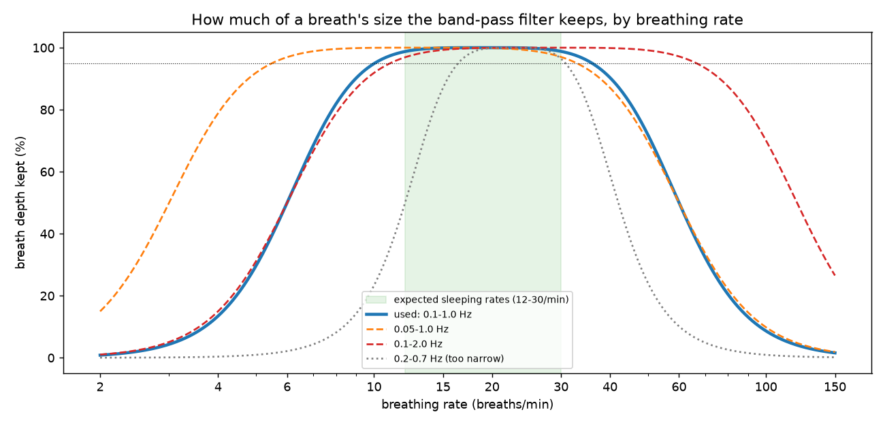
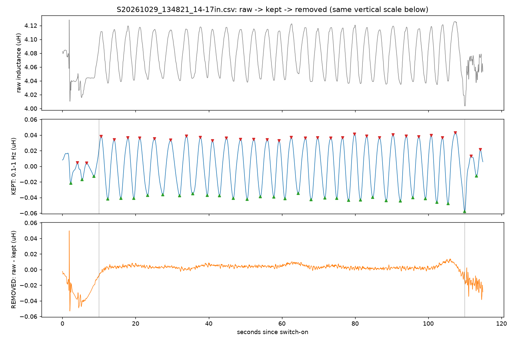
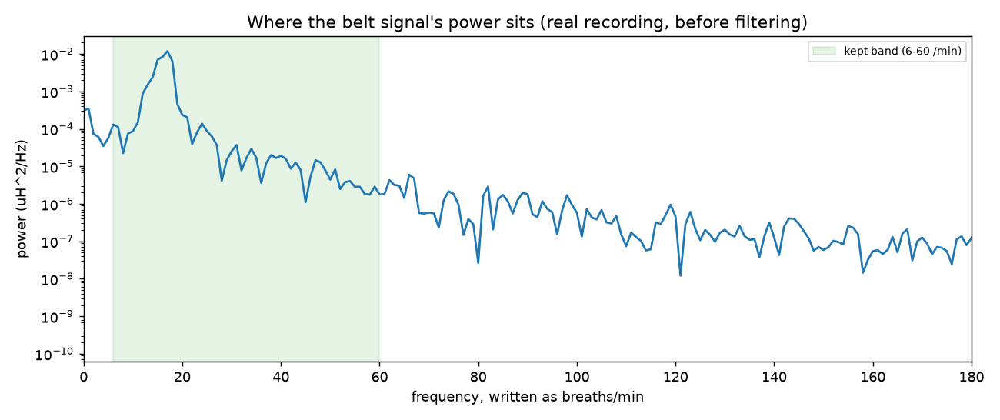
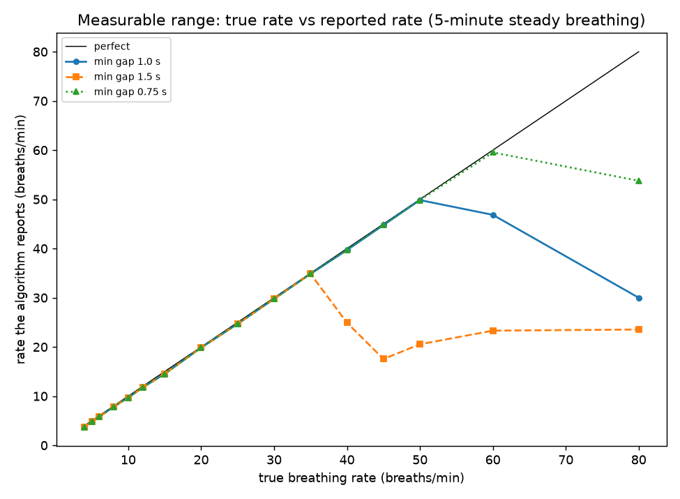
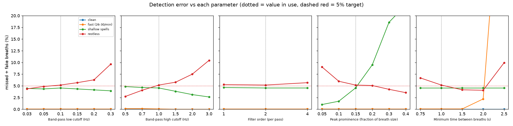
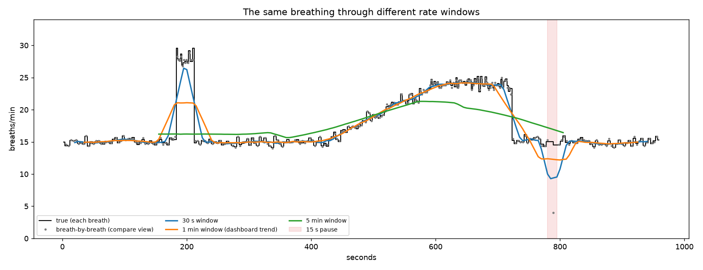
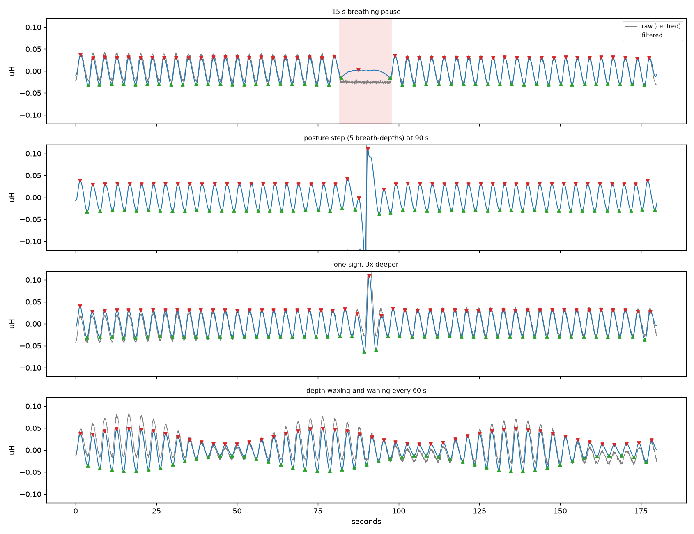
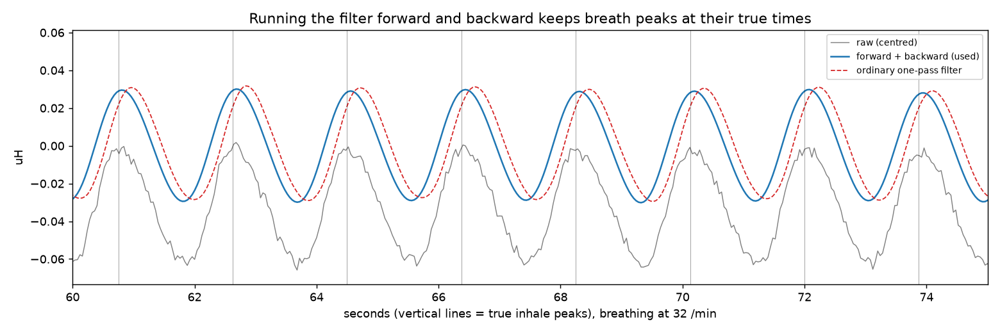

# Filtering: what we chose, why, and what it costs

This document answers one question: **are we filtering away real information to make the signal look clean?**

Every number here was measured by `tools/filter_study.py` and `tools/validate.py`. To regenerate the figures and tables, run both scripts (commands at the end). The full tables are in `docs/figures/filtering/RESULTS.md` and `docs/VALIDATION.md`.

## Short answer

- **The filter removes little, and what it removes is visible.** On our real belt recording, 97.9% of the signal's power is inside the band we keep. The removed part is about 10 times smaller than the breathing.
- **Nothing is hidden.** The upload page can show the raw signal, the filtered signal, and "removed by the filter" for any recording. Rejected readings are counted and shown as gaps.
- **The breath count barely depends on the filter settings.** Moving either cutoff by a factor of 2 changes the count on the real belt file by at most one breath in 27.
- **The study found three real limits, and all three have been addressed.** The last two were trade-offs, so each fix has a measured cost:
  1. **Fixed:** the filter distorted breath holds, so pauses of 11–15 s were mostly missed.
  2. **Changed on 2026-11-17:** breathing faster than about 35 breaths/min was reported as roughly half its true rate. The minimum time between breaths went from 1.5 s to 1.0 s, and rates up to 50 breaths/min are now within 1%. The cost is more fake breaths from movement, which shows up only in minutes already labelled poor.
  3. **Changed on 2026-11-17:** breaths shallower than about 35% of normal were missed about a third of the time. The peak threshold went from 0.2 to 0.15, which halves that. It was not lowered further, because 0.1 counts noticeably more noise as breaths.

## The processing steps and their parameters

The device samples the belt 25 times a second. Each step below runs in this order.

| Step | Setting | What it is based on | What it costs |
|---|---|---|---|
| Reject stuck readings | same value for over 0.5 s | A working sensor never repeats a 28-bit reading exactly | None for a working sensor |
| Reject out-of-range readings | outside 0.5–100 µH | The belt rests near 4–5 µH | None |
| Reject spikes | over 0.5 µH from the 1 s median | A breath is about 0.06 µH, so 0.5 µH is about 8 breath depths | A very large, fast movement becomes a gap instead of a spike |
| Bridge short gaps | straight line across 2 s or less | The filter cannot run across missing samples | One fast breath could be flattened if it falls in a gap |
| Band-pass filter | 0.1–1.0 Hz, Butterworth, order 2, run forward and backward | 6–60 breaths/min covers the breathing rates we expect | Shrinks breaths slower than 10/min or faster than 36/min; distorts flat stretches |
| Find breaths | peaks at least 1.0 s apart, standing out by 15% of typical breath size | Separates breaths from noise wiggles | Correct up to about 50 breaths/min; misses some breaths under 35% of normal depth; movement can add fake breaths |
| Find pauses | movement under 20% of a typical breath for over 10 s | Runs on the cleaned signal, before the band-pass | Reads about 1 s long; cannot see a blocked airway |
| Rate window | 1 minute (trend) or breath by breath (compare view) | See "Short changes or long trends" | A longer window hides short events |

## 1. Which breathing rates the filter keeps



| Breaths/min | 4 | 6 | 8 | 10 | 12 | 15 | 20 | 30 | 40 | 50 | 60 | 80 |
|---|---|---|---|---|---|---|---|---|---|---|---|---|
| Breath depth kept (%) | 13 | 50 | 82 | 95 | 99 | 100 | 100 | 99 | 90 | 72 | 50 | 20 |

- The filter keeps at least 95% of a breath's depth from **10 to 36 breaths/min**.
- "0.1–1 Hz" is where the depth has fallen to 50%, not where it starts to fall. The filter runs twice (forward and backward), so its effect at the cutoffs is doubled.
- **Why 0.1 Hz at the low end:** it removes drift. Drift comes from the belt settling and from posture changes, which take tens of seconds to minutes.
- **Why 1 Hz at the high end:** it removes sensor noise, and anything faster than 60 breaths/min is not breathing.
- **Effect on the data:** breath *depth* is under-reported outside 10–36 breaths/min. The breath *count* is not affected in that way (see section 4).

## 2. What the filter removes from a real recording



The bottom panel is everything the filter took out, on the same scale as the kept signal. Between the dotted lines (the counting window) it is a nearly flat line: slow drift plus a little noise. It contains no breath-shaped features.



| Part of the signal | Share of power |
|---|---|
| Slower than 0.1 Hz (drift, settling) | 1.7% |
| 0.1–1 Hz (kept) | 97.9% |
| Faster than 1 Hz (noise) | 0.2% |

Inside the counting window, the kept signal's spread is 27.3 nH and the removed part's is 2.8 nH.

**Caveat:** this is one recording of a healthy adult breathing normally for two minutes. Test 2 will show whether the same holds for more people and postures.

## 3. How many readings are rejected

| Recording | Rejected readings |
|---|---|
| Belt, normal breathing (`S20261029_134821`) | 0% |
| Belt, `S20261103_135933` | 0% |
| Bench test, key moved over a coil (two files) | 3.5% and 6.5% |
| Faulty sensor start-up (two files) | 44% and 92%, mostly "stuck" |
| Synthetic nights (stable and noisy, 1 h each) | 0% |

- On real breathing, glitch rejection removed nothing.
- The files with heavy rejection had a sensor that was not updating. The dashboard flags any recording with more than 20% rejected as "sensor unreliable".
- Rejected readings become gaps. Gaps longer than 2 s stay visible and are never filled in.

## 4. The range of rates the algorithm can measure



| True rate (breaths/min) | 5–35 | 40 | 45 | 50 | 60 | 80 |
|---|---|---|---|---|---|---|
| Before (minimum gap 1.5 s) | within 4% | 24.9 | 17.5 | 20.5 | 23.3 | 23.5 |
| **Now (minimum gap 1.0 s)** | within 4% | 39.7 | 44.8 | 49.9 | 46.9 | 30.0 |

- From 5 to 35 breaths/min the reported rate is within 4% of the truth. It reads slightly low because only complete breaths inside the counting window are counted, which drops up to one breath at each end.
- **With the old 1.5 s gap, anything above about 35 breaths/min was wrong, and it looked normal.** The cause was the breath detector, not the band-pass: 1.5 s between breaths is a ceiling of 40 breaths/min.
- **With 1.0 s, rates up to 50 breaths/min are within 1%.** Above that, two limits meet: the filter has shrunk breaths to about half their depth at 60/min, and the 1.0 s gap is a hard ceiling of 60/min. Rates above 50/min are still under-reported.
- **The cost of 1.0 s:** a jolt of movement can now be counted as a fast breath. On whole synthetic nights, accuracy on good minutes did not change. On minutes touched by an artifact, which are already labelled poor and shaded, the share within 5% fell from 84–90% to 57–72% (see the validation summary).

## 5. What happens when each parameter is changed



Each panel changes one setting and leaves the rest alone. The error is missed breaths plus fake breaths, as a percent of the true breaths, over 20 synthetic three-minute trials per set. A missed breath and a fake breath cannot cancel out.

| Setting | Range tried | Clean | Fast (26–30/min) | Shallow spells | Restless | Real belt count (27 by eye) |
|---|---|---|---|---|---|---|
| Low cutoff | 0.03–0.3 Hz | 0% | 0.1% | 3.9–4.6% | 4.4–9.6% | 27 at every value |
| High cutoff | 0.5–3 Hz | 0% | 0–0.1% | 2.6–4.9% | 2.7–10.5% | 27, or 26 above 1 Hz |
| Filter order | 1, 2, 4 | 0% | 0.1% | 4.6–4.7% | 5.2–5.7% | 27 at every value |
| Peak prominence | 0.05–0.4 | 0% | 0.1% | 1.0–22.3% | 3.6–9.0% | 27 at every value |
| Minimum gap | 0.75–2.5 s | 0% | 0.1–59.6% | 4.6% | 4.1–9.9% | 27 at every value |

The errors with each combination of the two detection settings:

| Minimum gap | Peak prominence | Clean | Fast | Shallow spells | Restless |
|---|---|---|---|---|---|
| 1.5 s | 0.2 (before) | 0% | 0.1% | 9.5% | 4.2% |
| 1.0 s | 0.2 | 0% | 0.1% | 9.5% | 5.1% |
| **1.0 s** | **0.15 (now)** | **0%** | **0.1%** | **4.6%** | **5.2%** |
| 1.0 s | 0.1 | 0% | 0.1% | 1.7% | 6.0% |

- **The band-pass cutoffs and the filter order are not sensitive.** Changing them does not move the clean or fast results, and the real belt count stays at 26–27. The result does not depend on a tuned filter.
- **Peak prominence is a real trade-off.** A lower value finds more shallow breaths and counts more noise as breaths. Going from 0.2 to 0.15 halved the shallow-spell error (9.5% to 4.6%) and raised the restless error by only 0.1 points. Going on to 0.1 cuts the shallow error further but raises the restless error by another 0.8 points, so we stopped at 0.15.
- **Minimum gap is a real trade-off** between fast breathing and restless recordings (section 4).

How shallow can a breath be and still be found? Breaths missed, grouped by depth relative to a normal breath:

| Peak prominence | Under 35% | 35–50% | 50–70% | 70% or more |
|---|---|---|---|---|
| 0.2 (before) | 93 of 258 | 0 of 176 | 0 of 35 | 0 of 521 |
| **0.15 (now)** | **43 of 258** | 0 of 176 | 0 of 35 | 0 of 521 |
| 0.1 | 15 of 258 | 0 of 176 | 0 of 35 | 0 of 521 |
| 0.05 | 5 of 258 | 0 of 176 | 0 of 35 | 0 of 521 |

Breaths at 35% of normal depth or more are never missed. Below 35%, about one in six is missed now, down from one in three.

## 6. Short changes or long trends: the rate window

The band-pass filter does not decide how quickly we can see the breathing rate change. The **rate window** does. A window is the stretch of time one rate value is averaged over.



The test signal has steady breathing at 15/min, a 30 s burst at 28/min, a slow rise to 24/min over three minutes, and a 15 s pause.

| Rate shown as | Highest rate seen in the 30 s burst (true: 28) | Lowest rate seen at the 15 s pause |
|---|---|---|
| Breath by breath | 28.9 | 4.0 |
| 30 s window | 26.5 | 9.3 |
| 1 minute window (dashboard trend) | 21.1 | 12.2 |
| 5 minute window | 16.2 | 16.6 |

- A window shows an event fully only if the event lasts at least as long as the window.
- **The 1 minute trend shows a 30 s burst at 21/min, not 28/min.** A 5 minute window hides it entirely.
- All four windows follow the three-minute rise, because it is longer than every window except the 5 minute one, which lags.
- **What the dashboard does:** the night view uses 1 minute values, which suits an eight-hour night and matches the validation target. The compare view for short trials uses breath-by-breath rate. Pauses are found separately and do not depend on the window.
- **Open question for the client:** whether the night view should also offer a 30 s or breath-by-breath rate when zoomed in.

## 7. Events before and after the filter



| Event | What the filter does |
|---|---|
| 15 s pause | **Distorts it.** The flat line is bent into a low hump with a fake peak (top panel). See below. |
| Posture step of 5 breath depths | Rings for several seconds around the step. The breaths there are unreliable. The step itself is visible in the raw view. |
| One sigh, 3 times deeper | Kept at nearly full size. The breaths next to it are slightly reduced. |
| Depth rising and falling every 60 s | Kept. Detected depth follows true depth with correlation 0.997. |

The last row matters. The filter removes slow changes in the **baseline**. It does not remove slow changes in the **breathing**. A breathing pattern that gets shallower and deeper over a minute still consists of breaths at 0.25 Hz, which are inside the band.

### The pause problem (found by this study, now fixed)

The band-pass removes everything slower than 0.1 Hz. A breath hold is exactly that: a flat line lasting 10 s or more. The filter pulls the flat line back toward zero, which creates a hump with a peak in the middle. The old pause rule looked for more than 10 s without a peak or trough in the filtered signal, so the fake peak hid the pause.

Pauses found, out of 10 recordings at each length:

| Pause length (s) | 6 | 8 | 11 | 13 | 15 | 20 | 30 | 45 |
|---|---|---|---|---|---|---|---|---|
| Old rule (filtered signal) | 0 | 0 | 0 | 0 | 3 | 10 | 10 | 10 |
| New rule (chest movement) | 0 | 0 | 10 | 10 | 10 | 10 | 10 | 10 |

Changing the cutoff did not fix it; it only moved which pause lengths were missed. The new rule does not use the band-passed signal. It reports a pause when the cleaned signal moves by less than 20% of a typical breath within every 3 s window, for more than 10 s. Drift is far too slow to matter over 3 s, so no high-pass filter is needed.

This is the clearest case of what the professors asked about: a filter chosen for one job (counting breaths) silently damaged another (finding pauses).

## 8. Why the filter runs forward and backward



How far the detected peak sits from the true peak, in milliseconds (one sample is 40 ms; plus means late):

| Breaths/min | 8 | 12 | 16 | 24 | 32 |
|---|---|---|---|---|---|
| Forward and backward (used) | 0 | 40 | 50 | 60 | 65 |
| One pass | −850 | −200 | 15 | 160 | 225 |

- An ordinary one-pass filter shifts breaths by a different amount at each breathing rate, by up to 0.85 s here. That would misplace breath markers and distort breath-by-breath timing.
- Running forward and backward cancels the shift. The remaining offset is one to two samples. It comes from removing the sharper parts of the breath shape, not from delay.
- The cost is that the whole recording is needed first, which is fine for a card that is read after the night.

## What we do so that nothing is hidden

- **Raw data is never changed.** The SD-card file is the record. Processing only reads it.
- **Three views of every uploaded recording:** raw belt inductance, filtered breathing with breath markers, and "removed by the filter".
- **Rejected readings are counted** in a "Readings removed" tile, with a warning above 20%.
- **Gaps stay gaps.** Only gaps of 2 s or less are bridged.
- **Each minute gets a quality label** (good, poor, no signal) from the signal-to-noise and signal-to-interference ratios, and poor minutes are shaded, not deleted.
- **The settings are listed on the page** under "How this recording was processed", generated from the code's own constants.

## Validation summary

From `docs/VALIDATION.md`: 12 synthetic nights (about 95 hours) compared minute by minute with the generator's known truth.

| Profile | Minutes within 5% (good minutes) | Median rate error | Pauses of 11 s or more found | False pause reports |
|---|---|---|---|---|
| Stable | 99.0% | 0.03% | 16 of 16 | 0 |
| Declining | 94.7% | 0.04% | 71 of 72 | 11 |
| Noisy | 99.2% | 0.07% | 9 of 9 | 0 |

- On minutes touched by an artifact or gap (labelled poor), 57–72% are within 5%, and the 95th-percentile error is 16–24%. With the old settings it was 84–90%; the drop is the cost of the 1.0 s minimum gap.
- Relative amplitude is within 0.1 of the truth on at least 99.8% of good minutes.
- The real belt recording gives 27 breaths against 27 visible by eye.
- The 11 false pause reports in the declining profile are stretches of very shallow breathing, which the movement rule cannot tell from a pause.

## Limits

- **Synthetic truth is our own model.** It shows the algorithm does what we intend. It cannot show that real children's breathing looks like the model. Test 2 (hand counts) and a comparison with the client's reference belt are the real checks.
- **One real breathing recording** is behind the "what is removed" figures.
- **Quality labels are not validated.** Every minute of the noisy synthetic profile is labelled "poor", and loose-band minutes are labelled "poor", not "no signal". The 15 dB and 10 dB thresholds are starting values to tune on Test 2 data.
- **Movement at breathing speed** (about 0.3 Hz) passes straight through the filter and can be counted as breaths.
- **One chest band cannot see a blocked airway.** If the child keeps trying to breathe, the chest keeps moving and no pause is reported.
- **Breath shape is not preserved.** The filter keeps the timing and size of each breath but smooths its shape, so we do not report anything based on shape.

## Open decisions

| Decision | Status |
|---|---|
| Upper rate limit | **Decided 2026-11-17:** 1.0 s minimum gap. Revisit if Test 2 recordings with movement show many fake breaths. |
| Shallow breaths | **Decided 2026-11-17:** prominence 0.15. Revisit on Test 2 data. |
| Rate window in the night view | Open: 1 minute only, or add a finer view when zoomed in. Ask the client. |

Both detection settings are single constants. In Python they are the defaults of `detect_breaths` in `tools/processing/breaths.py`; in TypeScript they are `MIN_PERIOD_S` and `PROMINENCE_FRACTION` in `web/src/lib/processing/breathing.ts`. After changing them, run `python export_web_processing.py` and `npm test` so the two copies are checked against each other.

## How to reproduce

```powershell
cd tools
.venv\Scripts\Activate.ps1
python filter_study.py     # figures and tables -> docs/figures/filtering/  (about 1 minute)
python validate.py         # docs/VALIDATION.md                             (about 1 minute)
```

`validate.py` needs the synthetic nights, which are not in git. Create them once with `python generate_sample_set.py`.
