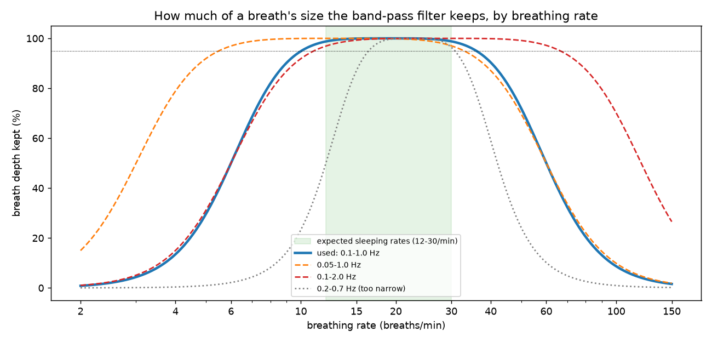
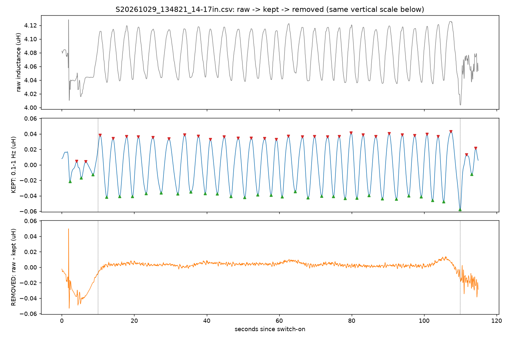
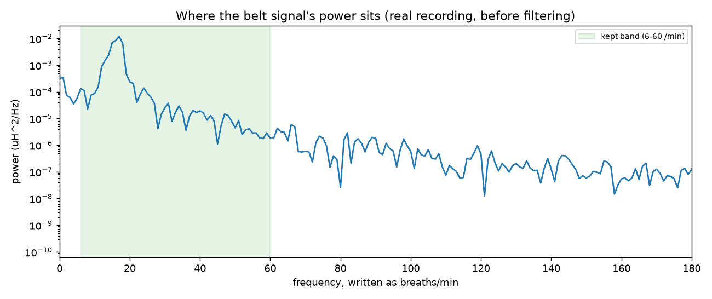
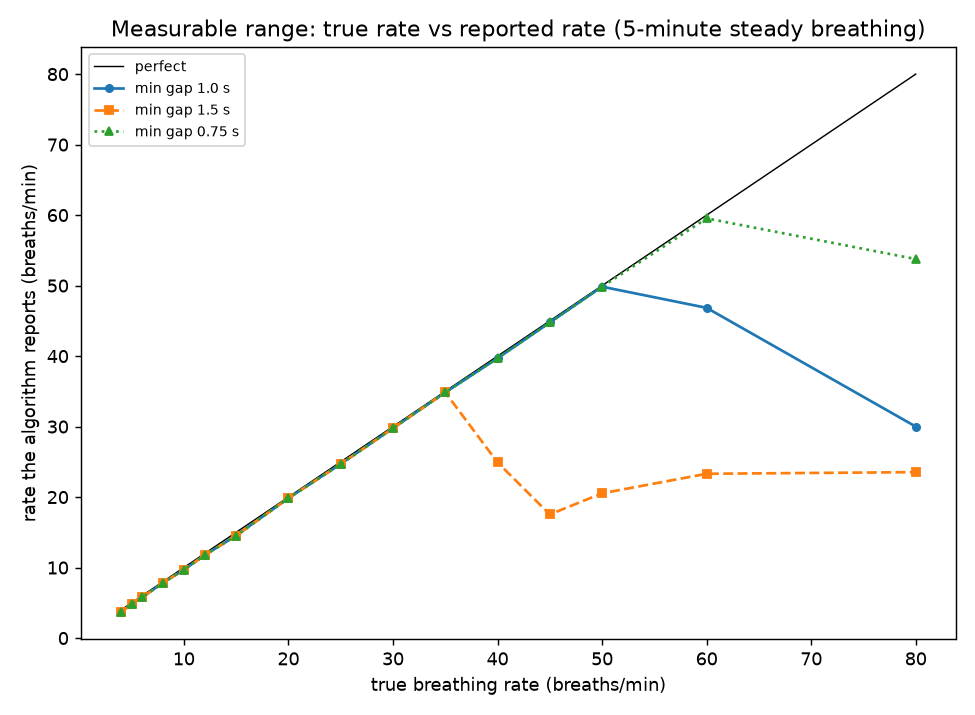
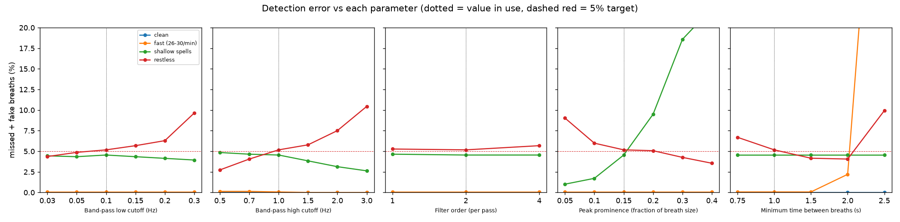
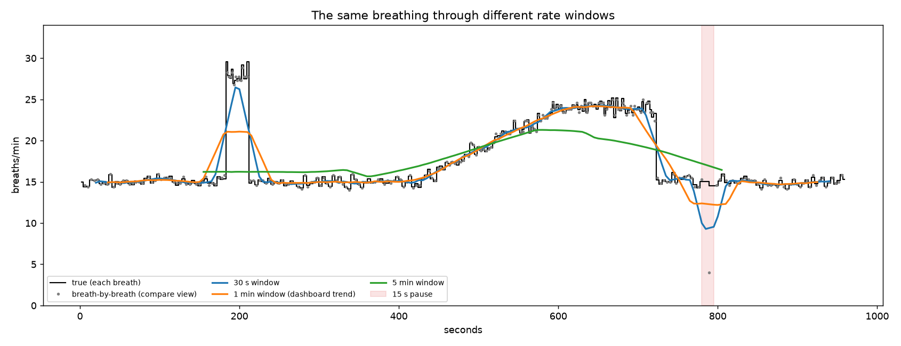
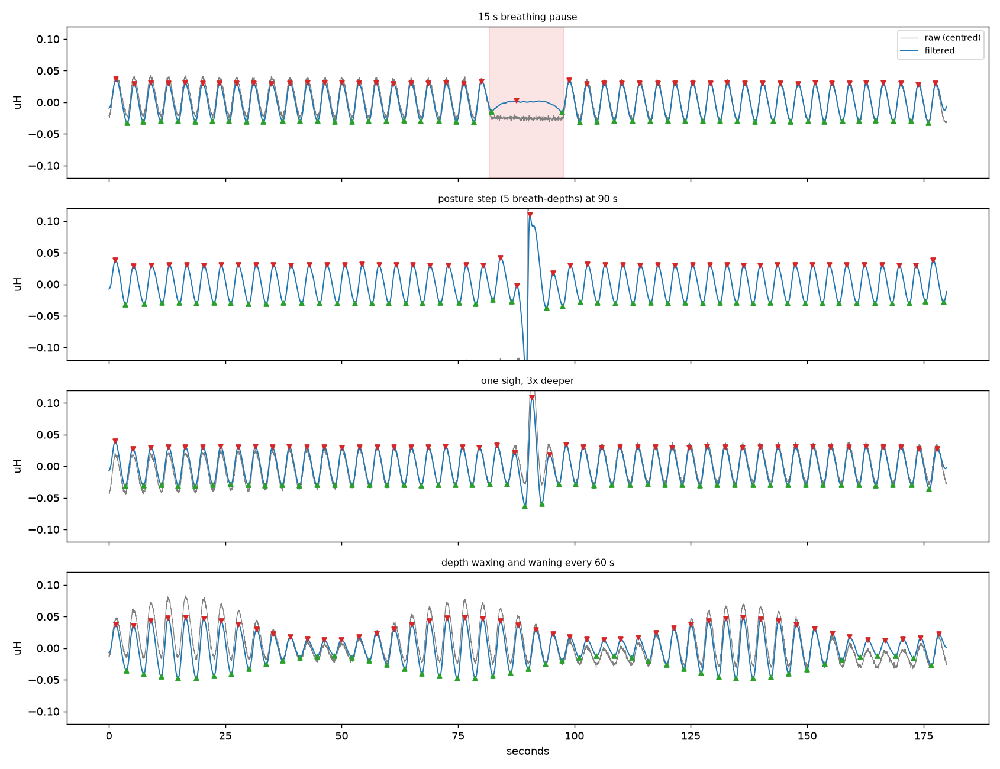
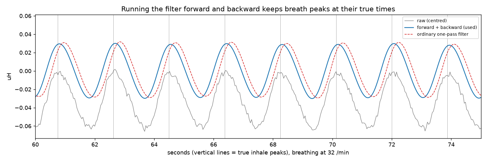

# Filter study results

Generated by `tools/filter_study.py`. Do not edit by hand.

## 1. Which breathing rates the band-pass keeps

| breaths/min | 4 | 6 | 8 | 10 | 12 | 15 | 20 | 30 | 40 | 50 | 60 | 80 |
|---|---|---|---|---|---|---|---|---|---|---|---|---|
| depth kept (%) | 13.00 | 50.00 | 82.00 | 95.00 | 99.00 | 100.00 | 100.00 | 99.00 | 90.00 | 72.00 | 50.00 | 20.00 |

- At least 95% of the depth is kept from **10 to 36 breaths/min**; at least 50% from 6 to 60.

## 2. What the filter removes from a real belt recording

| part of the signal | share of power (%) |
|---|---|
| slower than 0.1 Hz (drift, settling) | 1.69 |
| 0.1-1 Hz (kept) | 97.89 |
| faster than 1 Hz (noise) | 0.20 |

- Readings rejected as glitches in this file: 0 of 2874.
- Inside the counting window the kept signal's spread (std) is 27.3 nH; the removed part's is 2.8 nH.

## 3. How many readings glitch removal rejects

Percent of that file's sensor readings. Rejected readings become gaps; gaps longer than 2 s stay visible as gaps and are never filled in.

| recording | length (s) | stuck (%) | out of range (%) | spike (%) | total (%) |
|---|---|---|---|---|---|
| S20261026_212356 | 118 | 0.00 | 0.00 | 3.46 | 3.46 |
| S20261026_212443 | 348 | 0.00 | 0.00 | 6.54 | 6.54 |
| S20261029_134821_14-17in | 115 | 0.00 | 0.00 | 0.00 | 0.00 |
| S20261103_135933 | 67 | 0.00 | 0.00 | 0.00 | 0.00 |
| S20261103_140336 | 69 | 37.97 | 0.17 | 5.71 | 43.85 |
| S20261103_143541 | 120 | 89.34 | 0.00 | 2.47 | 91.81 |
| S20261103_234406 | 17 | 0.00 | 0.00 | 0.00 | 0.00 |
| synthetic stable, 1 h | 3600 | 0.00 | 0.00 | 0.00 | 0.00 |
| synthetic noisy, 1 h | 3600 | 0.00 | 0.00 | 0.00 | 0.00 |

## 4. The range of rates the algorithm can measure

With today's settings (min gap 1.0 s):

| true rate (/min) | reported (/min) | error (%) | depth kept (%) |
|---|---|---|---|
| 4 | 3.69 | -7.69 | 21.53 |
| 5 | 4.85 | -3.08 | 36.29 |
| 6 | 5.77 | -3.85 | 52.78 |
| 8 | 7.85 | -1.92 | 82.87 |
| 10 | 9.69 | -3.08 | 95.02 |
| 12 | 11.77 | -1.92 | 99.34 |
| 15 | 14.54 | -3.08 | 100.36 |
| 20 | 19.85 | -0.77 | 100.50 |
| 25 | 24.69 | -1.23 | 100.11 |
| 30 | 29.77 | -0.77 | 98.49 |
| 35 | 34.85 | -0.44 | 95.40 |
| 40 | 39.69 | -0.77 | 89.88 |
| 45 | 44.77 | -0.51 | 81.44 |
| 50 | 49.85 | -0.31 | 71.38 |
| 60 | 46.85 | -21.92 | 50.97 |
| 80 | 30.00 | -62.50 | 22.01 |

## 5. What happens when each parameter is changed

One parameter changes at a time; the rest stay at today's values (**bold** row). Error = missed breaths + fake breaths, as a percent of the true breaths, over 20 synthetic 3-minute trials per set (truth known exactly; a missed and a fake breath cannot cancel). Belt = complete breaths counted in the real belt file (27 visible by eye).

**Band-pass low cutoff (Hz)**

| value | clean (%) | fast (26-30/min) (%) | shallow spells (%) | restless (%) | belt count |
|---|---|---|---|---|---|
| 0.03 | 0.00 | 0.07 | 4.44 | 4.36 | 27 |
| 0.05 | 0.00 | 0.07 | 4.34 | 4.87 | 27 |
| **0.1** | 0.00 | 0.07 | 4.55 | 5.17 | 27 |
| 0.15 | 0.00 | 0.07 | 4.34 | 5.68 | 27 |
| 0.2 | 0.00 | 0.07 | 4.14 | 6.29 | 27 |
| 0.3 | 0.00 | 0.07 | 3.94 | 9.63 | 27 |

**Band-pass high cutoff (Hz)**

| value | clean (%) | fast (26-30/min) (%) | shallow spells (%) | restless (%) | belt count |
|---|---|---|---|---|---|
| 0.5 | 0.00 | 0.13 | 4.85 | 2.74 | 27 |
| 0.7 | 0.00 | 0.13 | 4.65 | 4.06 | 27 |
| **1.0** | 0.00 | 0.07 | 4.55 | 5.17 | 27 |
| 1.5 | 0.00 | 0.00 | 3.84 | 5.78 | 26 |
| 2.0 | 0.00 | 0.00 | 3.13 | 7.51 | 26 |
| 3.0 | 0.00 | 0.00 | 2.63 | 10.45 | 26 |

**Filter order (per pass)**

| value | clean (%) | fast (26-30/min) (%) | shallow spells (%) | restless (%) | belt count |
|---|---|---|---|---|---|
| 1 | 0.00 | 0.07 | 4.65 | 5.27 | 27 |
| **2** | 0.00 | 0.07 | 4.55 | 5.17 | 27 |
| 4 | 0.00 | 0.07 | 4.55 | 5.68 | 27 |

**Peak prominence (fraction of breath size)**

| value | clean (%) | fast (26-30/min) (%) | shallow spells (%) | restless (%) | belt count |
|---|---|---|---|---|---|
| 0.05 | 0.00 | 0.07 | 1.01 | 9.03 | 27 |
| 0.1 | 0.00 | 0.07 | 1.72 | 5.98 | 27 |
| **0.15** | 0.00 | 0.07 | 4.55 | 5.17 | 27 |
| 0.2 | 0.00 | 0.07 | 9.49 | 5.07 | 27 |
| 0.3 | 0.00 | 0.07 | 18.59 | 4.26 | 27 |
| 0.4 | 0.00 | 0.07 | 22.32 | 3.55 | 27 |

**Minimum time between breaths (s)**

| value | clean (%) | fast (26-30/min) (%) | shallow spells (%) | restless (%) | belt count |
|---|---|---|---|---|---|
| 0.75 | 0.00 | 0.07 | 4.55 | 6.69 | 27 |
| **1.0** | 0.00 | 0.07 | 4.55 | 5.17 | 27 |
| 1.5 | 0.00 | 0.07 | 4.55 | 4.16 | 27 |
| 2.0 | 0.00 | 2.20 | 4.55 | 4.06 | 27 |
| 2.5 | 0.00 | 59.55 | 4.55 | 9.94 | 27 |

**How shallow can a breath be and still be found?** Breaths missed, grouped by depth relative to a normal breath (20 trials with shallow spells):

| peak prominence | under 35% | 35-50% | 50-70% | 70% or more |
|---|---|---|---|---|
| 0.2 | 93 of 258 | 0 of 176 | 0 of 35 | 0 of 521 |
| 0.15 (used) | 43 of 258 | 0 of 176 | 0 of 35 | 0 of 521 |
| 0.1 | 15 of 258 | 0 of 176 | 0 of 35 | 0 of 521 |
| 0.05 | 5 of 258 | 0 of 176 | 0 of 35 | 0 of 521 |

## 6. Short changes vs long trends: the rate window

True values: steady 15 /min, a 30 s burst at 28 /min, a 15 s pause (a 15 s gap = 4 /min breath-by-breath).

| rate shown as | highest rate seen in the burst (/min) | lowest rate seen at the pause (/min) |
|---|---|---|
| breath-by-breath | 28.85 | 3.97 |
| 30 s window | 26.45 | 9.28 |
| 1 min window (dashboard trend) | 21.09 | 12.19 |
| 5 min window | 16.22 | 16.60 |

## 7. Clinically interesting events, before and after the filter

| event | true complete breaths | counted | pauses > 10 s reported (movement rule, used now) | old rule (gaps in the filtered signal) |
|---|---|---|---|---|
| 15 s breathing pause | 44 | 43 | 81.7-97.8 s | none |
| posture step (5 breath-depths) at 90 s | 48 | 47 | none | none |
| one sigh, 3x deeper | 47 | 46 | none | none |
| depth waxing and waning every 60 s | 47 | 46 | none | none |

The true pause in the first row starts at about 80 s and lasts 15 s. Pauses found out of 10 recordings each (16 breaths/min, pause length varied):

| pause length (s) | 6 | 8 | 11 | 13 | 15 | 20 | 30 | 45 |
|---|---|---|---|---|---|---|---|---|
| old rule (gaps in the filtered signal) | 0/10 | 0/10 | 0/10 | 0/10 | 3/10 | 10/10 | 10/10 | 10/10 |
| movement rule (used now) | 0/10 | 0/10 | 10/10 | 10/10 | 10/10 | 10/10 | 10/10 | 10/10 |

- Waxing/waning depth: detected breath depth follows the true depth with correlation r = 0.997; median detected/true depth = 1.01.

## 8. Why the filter runs forward and backward

How far the detected inhale peak sits from the true one (median, ms; one sample = 40 ms; + means late):

| breaths/min | forward + backward (used) | one pass |
|---|---|---|
| 8 | 0 | -850 |
| 12 | 40 | -200 |
| 16 | 50 | 15 |
| 24 | 60 | 160 |
| 32 | 65 | 225 |
